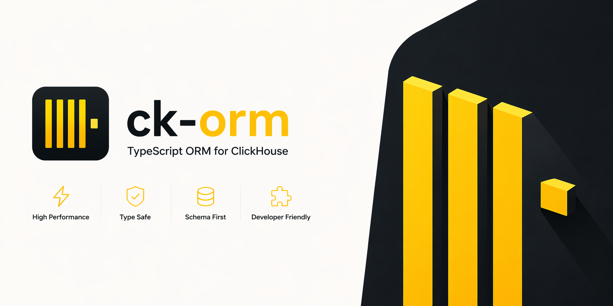

## ⚠️ Before version 0.1.0, there will be significant API adjustments. If needed, please pin the version number.


# CK-ORM

<p align="center">
  
</p>

<p align="center">
  <a href="https://npmjs.com/package/ck-orm"></a>
  <a href="https://npmjs.com/package/ck-orm"></a>
  <a href="https://github.com/MunMunMiao/ck-orm/actions/workflows/ci.yml"></a>
  <a href="https://github.com/MunMunMiao/ck-orm/blob/main/LICENSE"></a>
</p>

<p align="center">
  A typed ClickHouse query layer for modern JavaScript runtimes.
</p>

It gives you:

- a schema DSL for ClickHouse tables and columns
- a typed query builder for the common path
- raw SQL when ClickHouse-specific syntax is the better tool
- session helpers for temporary-table workflows
- observability through a logger and query lifecycle plugins, with OpenTelemetry tracing in `ck-orm/otel`

## Installation

```bash
bun add ck-orm
npm install ck-orm
pnpm add ck-orm
yarn add ck-orm
```

ck-orm has no required dependencies. OpenTelemetry tracing is a separate entry point, `ck-orm/otel`, and `@opentelemetry/api` is an optional peer dependency used only by it. The main `ck-orm` entry never imports OpenTelemetry, so an application, browser bundle or edge worker that does not trace installs and bundles none of it. To trace queries, install the API and an SDK, then follow the [OpenTelemetry plugin setup](https://ck-orm.lyz.cloud) in the reference.

## Example

```ts
import { ck, ckTable, ckType, clickhouseClient, fn } from "ck-orm";

const probes = ckTable("probes", {
  probeId: ckType.string("probe_id"),
  signal: ckType.decimal({ precision: 20, scale: 5 }),
  status: ckType.int16(),
});

const db = clickhouseClient({ host: "http://127.0.0.1:8123" });

const rows = await db
  .select({ probeId: probes.probeId, total: fn.sum(probes.signal).as("total") })
  .from(probes)
  .where(ck.eq(probes.status, 1))
  .groupBy(probes.probeId);
// rows: { probeId: string; total: string }[]
```

## Documentation

- **[ck-orm.lyz.cloud](https://ck-orm.lyz.cloud)**: the full reference, covering the schema DSL, query builder, writes, raw SQL, sessions, observability, errors and security.
- **[llms.txt](https://ck-orm.lyz.cloud/llms.txt)**: the same reference for AI coding agents, with one markdown file per section.
- **[`examples/`](./examples)**: runnable examples, each a `main.ts` with a `main.test.ts` and a `package.json`; the site shows the SQL each one sends.
- **[`e2e/`](./e2e)**: runnable scenarios against a real ClickHouse server.

The documentation source lives in [`docs/`](./docs).

## License

[MIT](./LICENSE)
